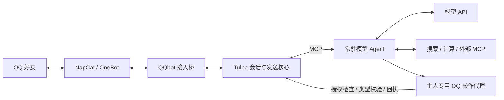

# QQbot Firefly

基于 **Tulpa MCP + NapCat + 大模型工具调用** 的 QQ 会话与自主操作机器人。当前版本为 **5.0.1**，支持独立好友会话、图片理解、连续消息合并，以及主人授权的 QQ 账号操作。5.0.1 增加掉线诊断与自动现场留档，详见 [诊断说明](docs/v5.0.1.md)；尚未宣称修复底层登录身份失效。

QQbot 负责驱动模型和连接工具；[Tulpa](https://github.com/fumingyang2004/Tulpa) 负责会话、人格、消息批次、权限检查、回复规划、发送队列与回执。模型的普通文字输出不会直接发送到 QQ，回复必须经过框架的规划和发送工具。

## 能做什么

| 能力 | 说明 |
| --- | --- |
| 好友私聊 | 每个好友使用独立会话、上下文和授权，支持重启后接续。 |
| 文字与图片 | 图片通过工具读取真实像素，再交给支持视觉的模型。 |
| 连续消息 | 默认停顿 1.2 秒后合并处理，最长收集 4 秒。 |
| 停止、更正和撤回 | 取消相关推理，发送前重新检查消息是否过时。 |
| 模型与人格 | 兼容原生 tools/tool_calls 的 Chat Completions API，可配置多个模型和人格文件。 |
| QQ 自主操作 | 主人可调用好友、消息、互动、资料、空间、群管理、群文件和相册工具，具体取决于接入接口和 QQ 权限。 |
| 好友申请 | 启用后，真实新申请可触发受限后台任务，由模型决定接受或拒绝。 |
| 外部 MCP | 按配置发现工具及完整 JSON Schema，无需修改聊天主循环。 |
| 云端运行 | 提供 Ubuntu 部署脚本、健康检查、异常恢复、定时备份和版本切换。 |

QQ 自主操作**默认关闭**，需要部署者明确登记授权。普通好友无法调用主人专用的账号操作代理。写操作有持久化回执、去重、频率限制和暂停开关；结果为 `UNKNOWN` 时不会自动重发。

## 工作流



普通回复使用 `plan_chat_reply → send_chat_reply`。主人执行账号操作时，模型先通过 `qq_tools` 查询实际可用动作和参数，再通过 `qq_execute` 执行；当前私聊的互动仍进入同一回复队列。好友申请后台任务只处理触发事件对应的申请人。

## 快速开始

### 1. 准备环境

- Docker 与 Docker Compose。
- Python 3.12 或更新版本，用于初始化配置和开发。
- 一个机器人 QQ 账号，以及与它互为好友的主人 QQ 账号。
- 支持原生工具调用的模型 API；看图还需要模型支持图片输入。

```bash
git clone https://github.com/firefly-of-sky/QQ_bot_firefly.git
cd QQ_bot_firefly
python3 scripts/init_config.py
cp tulpa.example.toml tulpa.toml
```

初始化脚本保留已有 `.env` 和 `config.toml`，为首次安装生成随机 OneBot / WebUI Token。已有安装不要覆盖自己的 `tulpa.toml`。

### 2. 配置账号和模型

在 `.env` 中填写 `OWNER_QQ` 和 `PRIMARY_API_KEY`。如需内置网页搜索，可另填 `TAVILY_API_KEY`。生成的 `ONEBOT_TOKEN` 需要与 NapCat 中的配置保持一致。

在 `config.toml` 中设置实际模型：

```toml
[models.primary]
base_url = "https://your-provider.example/v1"
model = "your-exact-model-id"
api_key_env = "PRIMARY_API_KEY"
supports_images = true
supports_tools = true
```

`base_url` 不包含 `/chat/completions`。按模型实际能力设置图片支持；默认 Tulpa 运行时需要原生工具调用。密钥只放在本地 `.env` 中。

```bash
docker compose build bot
docker compose run --rm --no-deps bot python -m qqbot --check-config
docker compose run --rm --no-deps bot python -m qqbot --check-model primary
```

模型连通性检查会调用真实 API，可能产生费用。

### 3. 登录 QQ 并启动

```bash
docker compose up -d napcat
```

打开 [本机 NapCat 管理页](http://127.0.0.1:6099/webui/)，使用 `.env` 的 `WEBUI_TOKEN` 登录管理页，再用机器人账号的手机 QQ 扫码确认。

在 NapCat 中配置正向 WebSocket：

- 容器内监听 `0.0.0.0:3001`。
- Token 与 `.env` 的 `ONEBOT_TOKEN` 一致。
- 开启消息段数组和自身消息上报。

```bash
docker compose up -d --no-deps bot
docker compose logs --tail=40 bot
docker compose exec bot python -m qqbot.health --status
```

出现 `QQbot Tulpa runtime ready` 后，从主人 QQ 向机器人发送消息。健康状态中的 `ready=true` 表示 QQ 和框架连接就绪；完整对话仍需要可用的模型服务。

## 常用命令

| 命令 | 用途 |
| --- | --- |
| `/help` | 查看聊天帮助。 |
| `/status` | 查看版本；主人还可看到模型别名和完整模型 ID。 |
| `/cancel` 或“不用查了” | 停止当前任务；已发出的消息不能因此撤回。 |
| `/reset` | 清理本私聊上下文并重新建立会话。 |
| `/models` | 主人查看模型列表及当前选择。 |
| `/model 别名` | 主人切换当前会话使用的模型。 |
| `/qq` | 主人查看各类 QQ 动作的可用数量。 |
| `/autonomy` | 主人查看自主操作是否暂停及能力数量。 |
| `/autonomy pause` | 暂停自主操作，仍可文字聊天；在途操作可能完成。 |
| `/autonomy resume` | 恢复已授权的自主操作。 |

`persona_file` 可指向自定义 UTF-8 Markdown 人格文件，容器中的 `personas/` 已挂载。人格文件和 `system_prompt` 合计最多 6000 字；修改后用 `/reset` 应用新的会话人格快照。

## 开启 QQ 自主操作

先为**实际安装的 NapCat** 生成接口清单，并将其放入机器人可读取的数据目录。清单生成工具是 `scripts/cloud/capabilities.py`；部署步骤和权限说明见 [5.0 文档](docs/v5.0.0.md)。然后在 `tulpa.toml` 明确登记授权，例如：

```toml
[autonomy]
enabled = true
authorization_id = "owner-consent-v5"
capabilities_file = "/data/tulpa/provider-actions.json"
background_friend_requests = true
writes_per_minute = 10
background_per_hour = 12
```

更新已有 `[autonomy]` 配置段，避免重复添加。授权 ID 是部署者的登记标识；相同 ID 不会自动补回管理员撤销的权限。配置后只需重启 bot，再用 `/qq` 核对。

动作清单中的“可用”表示接入程序注册了接口，最终还要通过 QQ 账号、目标、群管理员权限和实际回执检查。2026-10-31 的部署检查中，八类框架动作有 54/63 项匹配已安装的 NapCat 注册表，这个数量不代表其他安装环境或每项真实 QQ 操作均已验收。

## 云端部署

提供适用于 Ubuntu 22.04、2 核 4 GiB 服务器的独立配置：

- `compose.cloud.yaml`：资源限制、日志轮转、重启策略及进程健康检查。
- `scripts/cloud/install-host.sh`：Docker、交换空间及宿主准备。
- `scripts/cloud/package.py`、`activate.sh`：源码打包和版本切换。
- `scripts/cloud/ops.py`：状态、备份、停止、启动及快捷登录设置。
- `deploy/systemd/`：进程守护与定时备份。

具体安装、SSH 隧道、数据迁移和回退步骤见 [云端部署说明](docs/cloud.md)。云端部署独立于个人电脑运行；不要把 NapCat、OneBot 或 Tulpa 管理端口开放到公网。

## 能力边界

- 群管理工具与自动群聊回复是不同能力，当前没有自动群聊回复。
- 支持处理收到的好友申请，尚未接入按任意 QQ 号主动搜索加好友。
- 当前已验收接入的空间接口支持发布、删除说说；不支持读取动态流、点赞或评论。其他接入版本以实际清单为准。
- 语音、视频、文件及相册操作受授权和接入方能力限制；语音转写只有接入方实际返回时才可使用。
- 账号凭据、安全设置和付费 API 不向模型开放；删除主人联系人也交由本人在 QQ 客户端确认。
- 框架最多同时运行 8 个会话，空闲好友会话可回收；不是无限会话服务。
- QQ 登录身份可能失效。进程自动重连和快捷登录不能代替账号本人手机确认，Docker `healthy` 也不等于 QQ 在线。
- 4.0.1 的精简上下文和合并短回复实验，在 5.0 中仍默认关闭。

## 开发与验证

```bash
python3 -m venv .venv
source .venv/bin/activate
python -m pip install -e .
python -m unittest discover -s tests -q

# 真实 Tulpa MCP，模型与 QQ 均为隔离夹具
python scripts/verify_qq_operator.py

# 真实模型，QQ 仍为隔离夹具；会产生 API 费用
python scripts/verify_qq_operator.py --real-model --allow-billable
```

5.0 的 Mac 和 amd64 镜像均通过过 163 项回归；真实模型的隔离验收与真实 QQ 操作分别记录在 [5.0 验收记录](docs/acceptance-v5.0.0.json)。真实群管理尚未验收，不能用模拟测试代替实际 QQ 权限检查。

聊天数据库、QQ 登录状态、API 密钥及生成的部署文件保存在本地或服务器的数据目录，未随源码上传。备份可能包含敏感数据，按私有配置保管。项目使用固定的 Tulpa 源码快照，不在启动时拉取上游；来源、版本和本地补丁见 [来源记录](vendor/tulpa-provenance.json)，上游许可见 [Tulpa LICENSE](vendor/tulpa/LICENSE)。

## 文档与版本

| 文档 | 内容 |
| --- | --- |
| [5.0 自主操作](docs/v5.0.0.md) | 授权、工具范围、操作回执、暂停与验收。 |
| [架构说明](docs/architecture.md) | Tulpa 会话核心和一轮对话的流程。 |
| [云端运行](docs/cloud.md) | 部署、监控、备份与恢复。 |
| [4.0 云端版本](docs/v4.0.0.md) | 云端部署验收与边界。 |
| [4.0.1 延迟实验](docs/v4.0.1.md) | 两项可选优化的对照与质量记录。 |
| [3.0 框架迁移](docs/v3.0.0.md) | 从旧运行时迁移至真实 Tulpa MCP。 |
| [2.1 使用说明](docs/README-2.1.md) | 历史版本操作与回退参考。 |
| [掉线调查](docs/incidents/2026-11-01-qq-offline.md) | 登录身份失效的证据与恢复记录。 |
