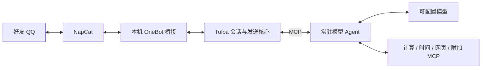

# QQbot 4.0 · Tulpa 会话机器人

4.0 增加独立的云端部署配置、进程与 QQ 就绪状态检查、异常会话恢复、定时备份和版本切换，适配 2 核 4 GiB 服务器。云端安装与日常操作见 [云端运行说明](docs/cloud.md)。云端真实上线状态以部署验收记录为准。

当前默认运行时已迁移到 [Tulpa](https://github.com/fumingyang2004/Tulpa) 的真实 MCP 服务。Tulpa 管理会话、人格快照、消息批次、回复规划、权限和发送回执；QQbot 作为常驻外部 Agent 驱动模型，并提供模型配置、QQ 接入及附加工具。



与 2.x 的区别：QQ 的发送与会话状态由框架拥有；模型使用发现到的 MCP JSON Schema 工具，必须完成 `plan_chat_reply → send_chat_reply`。增加外部 MCP 服务只需配置，不必修改 Bot 主循环。详情见 [架构](docs/architecture.md)、[3.0 迁移与验收](docs/v3.0.0.md)。

支持好友私聊、文字和图片、连续消息合并、自然停止与更正、独立上下文、主人切换模型、重启接续，以及 Tulpa 的表达学习协议。群聊、语音、发文件和账号管理权限默认关闭。Tulpa 当前最多同时运行 8 个会话；普通好友空闲后释放，容量满时回收空闲会话。

## 启动

需要 Docker、一个机器人 QQ 号、两个账号互加好友，以及支持原生 `tools/tool_calls` 的 Chat Completions 兼容模型 API。

```bash
python3 scripts/init_config.py
cp tulpa.example.toml tulpa.toml # 首次使用；已有文件请勿覆盖
```

在本机 `.env` 填写 `OWNER_QQ`（主人账号）、`PRIMARY_API_KEY`；`ONEBOT_TOKEN` 与 `WEBUI_TOKEN` 由初始化脚本生成。不要把密钥发到聊天。`config.toml` 的模型需要准确的 `base_url`、`model` 和 `api_key_env`，并设置 `supports_tools = true`。

```bash
docker compose build bot
docker compose run --rm --no-deps bot python -m qqbot --check-config
docker compose run --rm --no-deps bot python -m qqbot --check-model primary
docker compose up -d napcat
```

在 [NapCat 管理页](http://127.0.0.1:6099/webui/) 扫码登录机器人。网络配置启用正向 WebSocket 服务：容器内监听 `0.0.0.0:3001`，Token 填 `.env` 中的 `ONEBOT_TOKEN`，开启消息段数组和自身消息上报。旧安装继续沿用已有设置，无需重建 NapCat。

```bash
docker compose up -d --no-deps bot
docker compose logs --tail=40 bot
```

出现 `QQbot Tulpa runtime ready` 后，向机器人发送消息。模型检查会产生 API 费用；登录状态通过真实 OneBot 验证。NapCat 离线时暂停发送，不以 Docker 容器运行代替账号在线。

## 聊天与人格

- 直接发送文字或图片；连续消息默认停顿 1.2 秒后处理，最长收集 4 秒。
- “不用查了”或 `/cancel` 停止当前任务；后续更正会使旧回复计划失效。
- `/status` 查看运行时，`/reset` 删除当前 Tulpa 会话缓存和本私聊历史，重新开始。
- 主人可用 `/models` 和 `/model 别名`。每个好友的会话、模型选择和凭据独立。
- `persona_file` 指向本地 UTF-8 Markdown，和 `system_prompt` 合计最多 6000 字。Tulpa 保存会话人格快照；修改文件后 `/reset` 应用。也可通过 Tulpa 管理命令选择预设人格。

图片由 `read_chat_image` 返回真实像素给模型。当前未提供语音转写和任意文件工具；添加框架权限前应先接入并验证对应外部 Agent 能力。

## 扩展工具

编辑 `tulpa.toml`，重启 bot。工具从 MCP 服务发现，支持数组、对象及嵌套 JSON Schema。`tools` 可限制暴露的名称；省略表示开放该服务全部工具。只添加你信任并愿意让机器人调用的服务。

```toml
[mcp_servers.knowledge]
url = "https://your-server.example/mcp"
token_env = "KNOWLEDGE_MCP_TOKEN"
tools = ["search", "lookup"]
```

密钥放 `.env`，模型看到 `knowledge__search` 等工具。非本机服务要求 HTTPS；本机 HTTP 可用于 Docker 容器内服务。当前支持 Streamable HTTP MCP，未实现 stdio、OAuth 交互登录和热增删服务。`auto_search` 关闭内置网页工具，不关闭显式配置的额外 MCP 服务。

## Tulpa 管理

原框架的终端管理服务在 bot 容器内部 `127.0.0.1:7861`，MCP 在 `127.0.0.1:18777/mcp`，均不暴露到宿主网络。管理凭据与每个好友的 MCP 凭据独立，权限为 `0600`。

```bash
docker compose exec bot python -m qqbot.tulpa.admin status
docker compose exec bot python -m qqbot.tulpa.admin sessions list
docker compose exec bot python -m qqbot.tulpa.admin personas
docker compose exec bot python -m qqbot.tulpa.admin events
```

更多命令用 `python -m qqbot.tulpa.admin --help` 查看。Tulpa 管理中的内置调查 Agent 模型设置不改变 QQbot 的模型配置；QQbot 模型仍由 `config.toml` 管理。表达学习由框架按真实他人用语收集并校验，外部 Agent 分阶段调用模型；它不是任意事实记忆或完整历史检索。

## 数据、验证与回退

- `bot-data` 卷中保留原 `chat.sqlite3`，新框架数据位于 `/data/tulpa`。迁移不删除旧历史；原私聊历史作为本会话的背景资料。新消息和发送凭据由 Tulpa 持久化。
- `/reset` 清除该会话上下文，不删除框架审计与独立的语言库；撤回消息从模型后续上下文排除，并取消相关推理。审计保留策略见 [迁移说明](docs/v3.0.0.md)。
- 源码与 MIT 许可固定在 `vendor/tulpa`，版本及数据路径与虚拟 DNS 补丁记录在 `vendor/tulpa-provenance.json`，不依赖启动时拉取 GitHub。

```bash
.venv/bin/python -m unittest discover -s tests -q
# 真实模型 + 真实 Tulpa MCP，QQ 端为隔离夹具；会产生 API 费用
.venv/bin/python -m scripts.verify_tulpa_model
```

[2.1 原使用说明](docs/README-2.1.md) 保留用于回退和兼容 CLI。旧版 Git 提交 `aad1f99` 与本机镜像 `qqbot-bot:2.1.0-rollback` 可恢复旧运行时；回退前停止新版，保留两个数据库，禁止同时运行两个回复进程。Mac 睡眠、Docker 停止或 QQ 登录失效时，机器人无法保持工作。
