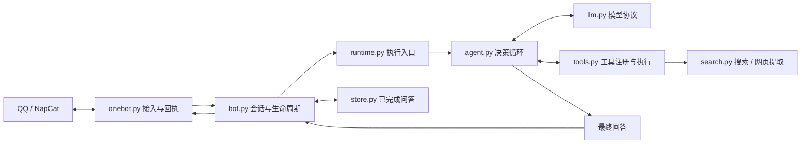

# QQbot 2.0 架构

## 数据流

## 职责边界

| 模块 | 职责 |
| --- | --- |
| `onebot.py` | QQ 连接、重连、事件队列、动作回执；收消息不等待模型 |
| `bot.py` | 好友校验、会话隔离、去重、命令、图片暂存、引用、取消和发送 |
| `runtime.py` | 组装图片与上下文，按模型配置选择 Agent 或兼容流程 |
| `agent.py` | 模型 → 工具 → 结果 → 模型循环、上下文预算、调用预算、总时限 |
| `llm.py` | Chat Completions HTTP、原生工具调用解析、协议错误检查 |
| `tools.py` | 工具声明、参数验证、超时、相同调用缓存、结果大小限制 |
| `search.py` | Tavily Search / Extract；旧搜索计划仅供兼容模式 |
| `prompts/` | 人格文件加载；每个新请求读取一次并固定本轮内容 |
| `store.py` | SQLite 已完成问答、模型选择、事件去重、撤回标记 |

Agent 不持有 QQ 发送对象或聊天数据库。工具不能任意指定接收者；只有会话层能将最终回复发送到当前请求所属用户。工具返回错误是模型可观察的数据，模型可修正参数、更换查询或说明不足。模型接口本身失败则结束本轮。

## 执行与取消

- 同用户串行，不同用户并发；全局并发上限覆盖图片处理和整轮 Agent 执行。
- 默认最多 6 轮允许工具调用的模型请求，另允许 1 次收尾请求；工具调用总计最多 8 次。达到工具数上限会提前进入收尾。
- 收尾请求使用 `tool_choice=none`；模型仍要求执行工具时终止，不越过限制。
- 同轮同工具同参数复用结果，仍占调用预算。鉴权/额度错误后本轮停止继续请求联网服务。
- 一轮 Agent 默认 240 秒；每个工具默认 30 秒。图片下载沿用独立时限。排队等待不计入 Agent 时限。
- `/cancel`、`/reset`、撤回沿现有 asyncio 任务链取消模型和工具；取消后不开始后续步骤。已派发到外部服务的请求不保证停止计费。
- 工具调用中的中间文字与 `reasoning_content` 不发送到 QQ；后者仅在当前工具循环中供需要它的模型协议回传。
- 最终答案成功发送后才写问答历史。工具结果、完整调用轨迹和原图不持久化；下轮需要核实网页内容时应重新读取。

## 上下文

上下文预算包含系统提示、人格、工具定义、问答与工具消息。图片 Base64 不按文本字节计算，另由图片数量和体积限制约束；预算是保守字节估算，并非精确 token 计数。

超限时先删除最早的完整历史问答，再删除较早的完整工具交换。始终保留当前问题和最新一组工具请求/结果，不会留下孤立 `role=tool` 消息。最小完整上下文仍放不下时明确报错，避免发送非法或残缺协议。

## 添加工具

1. 编写 `async handler(arguments: dict)`，返回可 JSON 序列化的结果；可恢复错误抛出 `ToolError`。
2. 用 `Tool(name, description, properties, required, handler, stage)` 注册到 `ToolRegistry`。
3. 在 `build_tools` 中显式决定该工具何时开放。当前参数校验支持字符串及布尔值；扩展其他 JSON 类型时同时扩展验证器和测试。
4. 为真实行为添加测试：错误参数、失败、超时、取消、权限范围和外部请求次数。

只注册工具即可让 Agent 发现和调用，无需修改 `Bot` 或为新话题增加路由分支。涉及写入、长记忆、文件或群管理的工具，需要先定义会话范围、取消和回执语义，不能直接复用当前只读工具的成功语义。

未来可以将工具层暴露成 MCP，或增加外部 MCP 工具适配器。当前版本没有 MCP 服务，也不依赖桌面 Agent 持续运行。
